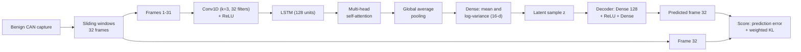

# CAN-bus intrusion detection with a CNN-LSTM variational autoencoder

An unsupervised anomaly detector for in-vehicle CAN traffic, written in MATLAB. A CNN-LSTM encoder with multi-head self-attention reads a window of CAN frames, a variational bottleneck compresses it, and a small decoder predicts the next frame. The model is trained on attack-free traffic only, so no attack labels are needed for training. A window is flagged when its score passes the 99th percentile of benign validation scores, which targets a 1% false-alarm rate.

The repository has pipelines for five public CAN datasets: Car-Hacking, OTIDS, CICIoV2024, ROAD and SynCAN.

> **Status.** The indexing bugs described under [Development notes](#development-notes) are fixed in this version. The corrected code has not been re-run yet, so this repository reports no performance figures.

## How it works



During training the latent vector is sampled with the reparameterisation trick. At test time the encoder mean is used directly. The loss and the anomaly score are the same quantity: mean squared error of the predicted frame plus the KL divergence of the latent distribution, weighted by β = 5 × 10⁻⁵.

There are two input variants.

| | Payload model (`payload_vae*.m`) | ID-embedding model (`id_vae_*.m`) |
|---|---|---|
| Features per frame | 8 payload bytes, standardised with benign mean and standard deviation | 16-d learned embedding of the CAN ID, plus 8 payload bytes scaled to [0, 1] |
| CAN ID | not used | embedded; IDs never seen in benign traffic share one "unknown" row |
| Attention heads | 4 | 2 |
| Window stride | 1 (8 in the ROAD version) | 4 |
| Batch size | 256 | 64 |
| Prediction loss | MSE on the 8 bytes | 5 × MSE on the embedding + MSE on the bytes |
| Extra score term | none | penalty × fraction of unseen IDs in the window (reported for penalties 0 to 5) |

Shared settings: window of 32 frames, 16-d latent space, 128 LSTM units, Adam with learning rate 10⁻⁴, at most 30 epochs, early stopping on the mean benign validation score (patience 5, minimum improvement 10⁻⁴).

The payload scripts also rank the 8 bytes against attack labels on a sample of up to 20,000 frames per class (mutual information in `payload_vae.m`, mRMR in `payload_vae_road.m`). All 8 bytes are kept, so the ranking only sets their order.

### Data handling

- The benign capture is split chronologically: first 60% for training, next 20% for validation (early stopping and threshold), last 20% for testing.
- Attack frames come from the dataset's attack captures. Benign and attack windows are built and scored as two separate streams.
- For Car-Hacking, the normal frames inside the attack captures are added to the benign test stream.
- Attack labels, as implemented:

| Dataset | Benign data | Attack frames |
|---|---|---|
| Car-Hacking | `normal_run_data.txt` | rows flagged `T` in the attack CSV |
| OTIDS | `Attack_free_dataset.txt` | DoS: ID 0x000. Impersonation: ID 0x164 from 250 s on. Fuzzy: every frame from 250 s on |
| CICIoV2024 (decimal) | `decimal_benign.csv` | every row of the attack file, e.g. `decimal_DoS.csv` |
| ROAD | first 30% of each of the 12 ambient captures | frames inside the injection interval in `capture_metadata.json`, limited to the injected ID when one is given |
| SynCAN | 30% of the training file(s), as ten evenly spaced chunks | rows labelled 1 in the test file |

## Repository layout

```
src/
  payload_vae.m               payload model: Car-Hacking, OTIDS, CICIoV2024
  payload_vae_road.m          payload model: ROAD (mRMR ranking, stride 8)
  id_vae_road.m               ID-embedding model: ROAD
  id_vae_otids.m              ID-embedding model: OTIDS
  id_vae_syncan.m             ID-embedding model: SynCAN
  prep/
    road_ambient_payload.m    builds ambient_diverse_30pct.mat (8 bytes per frame)
    road_ambient_with_id.m    builds new_ambient_diverse_30pct.mat (ID + 8 bytes)
```

Each script carries its own loaders, model, training loop, evaluation and helper functions, so it runs on its own.

## Requirements

- MATLAB R2023a or later (`selfAttentionLayer` first appeared in R2023a)
- Deep Learning Toolbox
- Statistics and Machine Learning Toolbox (`fscmrmr`, `perfcurve`, `confusionmat`)

Training runs on CPU. A full Car-Hacking run builds several hundred thousand training windows, so expect long runs.

## Datasets

The datasets are not redistributed here. Download them from their official pages and follow each provider's terms of use.

| Dataset | Files the scripts expect | Source |
|---|---|---|
| Car-Hacking (HCRL) | `normal_run_data.txt`, `DoS_dataset.csv`, `Fuzzy_dataset.csv`, `gear_dataset.csv`, `RPM_dataset.csv` | [ocslab.hksecurity.net](https://ocslab.hksecurity.net/Datasets/car-hacking-dataset) |
| OTIDS (HCRL CAN-intrusion) | `Attack_free_dataset.txt`, `DoS_attack_dataset.txt`, `Fuzzy_attack_dataset.txt`, `Impersonation_attack_dataset.txt` | [ocslab.hksecurity.net](https://ocslab.hksecurity.net/Dataset/CAN-intrusion-dataset) |
| CICIoV2024 | `decimal_benign.csv` and an attack file such as `decimal_DoS.csv` | [unb.ca/cic](https://www.unb.ca/cic/datasets/iov-dataset-2024.html) |
| ROAD | `ambient/ambient_*.log`, an attack log such as `fuzzing_attack_1.log`, `capture_metadata.json` | [0xsam.com/road](https://0xsam.com/road/) |
| SynCAN | `train_1.csv` (to `train_4.csv`), `test_continuous.csv` | [github.com/etas/SynCAN](https://github.com/etas/SynCAN) |

## How to run

1. Put the files of one dataset in a single folder.
2. ROAD only: set `ambient_dir` at the top of the matching script in `src/prep/` and run it from that folder. It writes the benign matrix the ROAD model scripts load.
3. In MATLAB:

```matlab
addpath(genpath('path/to/can-bus-ids-cnn-lstm-vae/src'))
cd('path/to/dataset/folder')
edit payload_vae      % set dataset_mode and attack_filename in section 0
payload_vae
```

Each script prints the window counts, the per-epoch losses, the threshold, and accuracy, precision, recall, F1, ROC AUC and the benign false-positive rate. The payload scripts also draw a confusion chart, and `payload_vae.m` saves ROC and precision-recall figures and `rawscores_<dataset>_<attack>.mat` with the raw benign and attack scores.

## Development notes

An earlier version of the payload scripts reported an AUC of about 0.998 on every Car-Hacking, OTIDS and CICIoV2024 attack it was run on, with recall 0.998046 each time. That uniformity was the clue: 0.998046 = 1 - 1/512, and 512 was the scoring batch size. MATLAB stores a `'CTB'`-formatted `dlarray` as channel × batch × time, so `X(:, end, :)` picked the last window of the batch instead of the last time step. Every window in a 512-window batch was therefore scored against one shared target, and the last window of each batch was never scored at all.

The ID-embedding scripts had a second layout bug: a `reshape` in the embedding lookup mixed embedding values from different windows. Both bugs are fixed in commit `f2288cd`, and an assertion now checks that every window gets a score. The corrected scripts have not been re-run end to end yet.

## Dataset references

- Seo, E., Song, H. M., & Kim, H. K. (2018). GIDS: GAN based intrusion detection system for in-vehicle network. *2018 16th Annual Conference on Privacy, Security and Trust (PST)*, 1-6. https://doi.org/10.1109/PST.2018.8514157
- Lee, H., Jeong, S. H., & Kim, H. K. (2017). OTIDS: A novel intrusion detection system for in-vehicle network by using remote frame. *2017 15th Annual Conference on Privacy, Security and Trust (PST)*. https://doi.org/10.1109/PST.2017.00017
- Neto, E. C. P., Taslimasa, H., Dadkhah, S., Iqbal, S., Xiong, P., Rahman, T., & Ghorbani, A. A. (2024). CICIoV2024: Advancing realistic IDS approaches against DoS and spoofing attack in IoV CAN bus. *Internet of Things, 26*, 101209. https://doi.org/10.1016/j.iot.2024.101209
- Verma, M. E., Bridges, R. A., Iannacone, M. D., Hollifield, S. C., Moriano, P., Hespeler, S. C., Kay, B., & Combs, F. L. (2024). A comprehensive guide to CAN IDS data and introduction of the ROAD dataset. *PLOS ONE, 19*, e0296879. https://doi.org/10.1371/journal.pone.0296879
- Hanselmann, M., Strauss, T., Dormann, K., & Ulmer, H. (2020). CANet: An unsupervised intrusion detection system for high dimensional CAN bus data. *IEEE Access, 8*, 58194-58205. https://doi.org/10.1109/ACCESS.2020.2982544

## Citation

If you use this code, please cite it with the metadata in [`CITATION.cff`](CITATION.cff) (GitHub shows a "Cite this repository" button for it).

## License

MIT. See [LICENSE](LICENSE).

## Author

Musab Nouman
